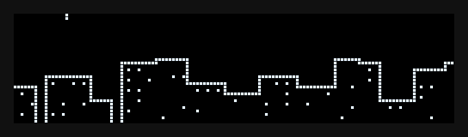

# Macropad

A wireless macropad with a customizable OLED screen, running [ZMK](https://zmk.dev) firmware on a nice!nano v2.



## Hardware

| Part                 | Notes                                           |
| -------------------- | ----------------------------------------------- |
| nice!nano v2         | nRF52840 controller, Pro Micro pinout           |
| hotswap switches     | Tactile buttons or MX-style mechanical switches |
| 0.91" OLED           | 128x32, SSD1306 driver, I2C (address `0x3C`)    |
| 3.7V LiPo (optional) | For wireless use, soldered to `B+` / `B-`       |

## Wiring

The keys are wired directly to pins, with no diode matrix. Each key connects one pin to GND, and the firmware enables the internal pull-up resistors. Switch pins have no polarity.

| From          | To nice!nano pin                                  |
| ------------- | ------------------------------------------------- |
| OLED `GND`    | `GND`                                             |
| OLED `VCC`    | `VCC` (3.3V, not `RAW`)                           |
| OLED `SCK`    | `020` (P0.20, I2C SCL)                            |
| OLED `SDA`    | `017` (P0.17, I2C SDA)                            |
| Battery + / − | `B+` / `B-` (check the polarity before soldering) |

The I2C bus has to use pins `017` and `020` on the nice!nano, so the keys can't use those pins.

## Keymap

Edit `boards/shields/macropad2/macropad2.keymap` to change them. Keycodes are listed in the [ZMK keycode reference](https://zmk.dev/docs/keymaps/list-of-keycodes).

## Building and flashing

GitHub Actions builds the firmware on every push (`build.yaml` targets board `nice_nano_v2` with shield `macropad2`, ZMK `v0.3`).

1. Push your changes, then open the Actions tab (or run `zmk dl`).
2. Download the build artifact and unzip it to get the `.uf2` file.
3. Connect the nice!nano over USB and short `RST` to `GND` **twice** quickly. A drive named `NICENANO` appears.
4. Drag the `.uf2` file onto the drive. The board restarts with the new firmware.

Shorting `RST` to `GND` **once** restarts the board without entering flashing mode.

## Configuration

User settings go in `config/macropad2.conf`.

| Setting                              | Effect                                                                                     |
| ------------------------------------ | ------------------------------------------------------------------------------------------ |
| `CONFIG_ZMK_DISPLAY_BLANK_ON_IDLE=n` | Keeps the screen on instead of blanking it after 30 seconds of inactivity (set by default) |
| `CONFIG_MACROPAD2_SCREEN_INVERT=y`   | Swaps lit and unlit pixels in the animation                                                |

The screen stays on and the animation runs constantly, so battery life is much shorter than with ZMK's default status screen.

## Repository layout

```
boards/shields/macropad2/
  macropad2.overlay        Key pins (direct kscan), matrix transform, OLED on I2C at 400 kHz
  macropad2-layouts.dtsi   Physical layout (n keys)
  macropad2.keymap         Default keymap
  Kconfig.defconfig        Enables the display and selects the custom status screen
  rain_screen.c            The rainy city animation (LVGL canvas, about 25 fps)
  CMakeLists.txt           Adds rain_screen.c to the build
config/
  macropad2.conf           User settings
  west.yml                 ZMK version (v0.3)
build.yaml                 GitHub Actions build targets
```

## Troubleshooting

- **The screen stays black:** check that `SDA` and `SCK` aren't swapped, that the OLED gets about 3.3V between `VCC` and `GND`, and that the breadboard contacts are good. A worn breadboard was the cause during prototyping.
- **The screen goes black after being unplugged and reconnected:** ZMK initializes the display only at boot. Restart the board by tapping `RST` to `GND` once.
- **A key does nothing:** confirm that the key's two legs are in different breadboard rows. Legs in the same row short the switch, and it reads as always pressed.
- **The animation looks like a negative:** set `CONFIG_MACROPAD2_SCREEN_INVERT=y` in `config/macropad2.conf`.
